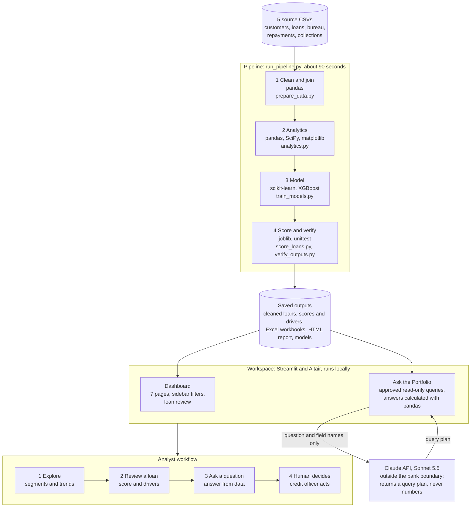

# Credit Risk Workspace

An integrated Streamlit dashboard and portfolio assistant for the supplied synthetic loan data.
The workspace contains 14,685 loan accounts belonging to 10,000 customers.

## Open the workspace

On Windows, double-click **Start_Dashboard.bat**. It uses the project environment automatically, opens the browser and reuses this project's server on port 8501 when available. Keep the server window open.

From this folder in PowerShell:

```powershell
.\.venv\Scripts\python.exe -X utf8 launch_chatbot.py
```

Open http://127.0.0.1:8501.

- Portfolio overview: lending concentration, product default rates, income and repayment charts.
- Trends over time: lending and default rate by origination quarter or year with control limits and a
  trend test, 30+ days past due by loan age and by calendar month.
- Customer segments: education/income heatmaps, employment and gender comparisons, bureau DPD groups,
  prior write-offs, outside-credit activity and age.
- Loan review: saved scores, evaluation partition and individual model contributions in plain names.
- Model performance: logistic regression and XGBoost comparisons, ROC and calibration charts, and the
  selected model's overall feature importance.
- Data quality: missing fields, missing bureau records and unknown bureau values.
- Integrated assistant: questions and shortcuts open supporting charts and evidence in Assistant analysis.
  "How the assistant works" states its trigger, false positives/negatives and the human review step.

Product, region, income and employment filters update the dashboard and supply chat context.
Answers show their own explicit filters. The model performance page always uses the fixed
held-out evaluation set and explains that the sidebar filters do not change it.

API credentials are configured privately on the server; there is no employee key-entry field.
The dashboard and labelled portfolio shortcuts work without a key. Natural-language questions
require Anthropic API access, configured as described in [Administrator setup](docs/ADMIN_SETUP.md).
The request format was checked against the Anthropic SDK and with a mocked response. No live API
call has been verified yet because no credential was configured; run one question after adding a key.

## Architecture and workflow

One command runs four pipeline steps in about 90 seconds; analysts then work in a local dashboard.
Only the typed question and field names cross the bank boundary to the AI: customer rows, incomes
and scores never leave the machine, and every figure is calculated locally with pandas.



Submission documents: [product brief](docs/PRODUCT_BRIEF.md), [assumptions log](docs/ASSUMPTIONS_LOG.md)
and the [Chief Risk Officer deck](docs/Credit_Risk_Workspace_CRO_Deck.pptx).

## Folder guide

| Folder | Contents |
|---|---|
| data/raw | Five original source CSVs and dictionary |
| data/processed | Cleaned loan-level data and saved scores |
| exports/excel | Six current Excel workbooks |
| scripts | Preparation, analysis, modelling, dashboard and assistant |
| tests | 39 offline guardrail, data, configuration and interface tests |
| models | Saved model pipelines and metadata |
| reports | Analysis, model evaluation and verification evidence |
| docs | Assignment PDF, product brief, assumptions log, deck, methodology and administrator guide |
| .venv | Local installed environment; excluded from submission ZIP |
| dist | Generated submission ZIP |

## Run the data and model pipeline

```powershell
.\.venv\Scripts\python.exe -X utf8 run_pipeline.py
```

This prepares all loans, produces analytics, compares logistic regression and XGBoost,
saves scores and verifies outputs. Use --skip-prepare to reuse the current cleaned CSV.

## Results to review

- exports/excel/analytics_base.xlsx: cleaned loans, dictionary and quality notes.
- exports/excel/portfolio_analytics.xlsx: analyses and cross-dimensional tables.
- exports/excel/risk_model_results.xlsx: model comparisons and evaluation.
- exports/excel/loan_risk_scores.xlsx: individual scores and model contributions.
- exports/excel/original_data_review.xlsx: original-information review with Missing markers.
- exports/excel/missing_values_review.xlsx: missing-data review.
- reports/analytics/analytics_report.html: charts and findings.
- reports/models/model_report.md: model results and limitations.

## Checks and submission

```powershell
.\.venv\Scripts\python.exe -m unittest discover -s tests -v
.\.venv\Scripts\python.exe scripts/verify_outputs.py
.\.venv\Scripts\python.exe scripts/package_submission.py
```

The submission ZIP excludes private credentials, the environment, caches and audit logs.
requirements.txt declares dependencies; requirements-lock.txt records installed versions.
See [Administrator setup](docs/ADMIN_SETUP.md) for installation on another machine.

Genuine unknowns remain blank in analytics. Model imputation is fitted on training data.
All loans for one customer stay in the same model partition. Scores classify the supplied
outcome; the data lacks confirmed default-event dates and a future prediction horizon.

See [Analytics and models](docs/ANALYTICS_AND_MODELS.md),
[Data preparation](docs/DATA_PREPARATION.md) and [Assistant design](docs/CHATBOT.md).
